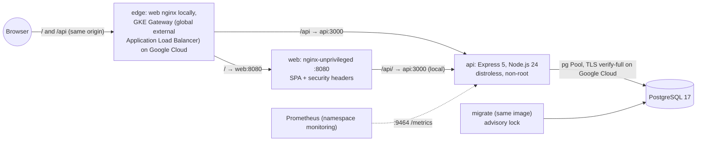

# dx03v2

Application half of the Google Cloud DevOps lab: a small message board (Express 5 API, React 19 page, PostgreSQL 17) with containers, Kubernetes manifests for GKE Autopilot and a kind end-to-end test.

[](https://github.com/maringelix/dx03v2/actions/workflows/ci.yml)

[Português](README.pt-BR.md)

**Fork this lab:** [FORK.md](FORK.md) takes you from a fork to a running lab, on your machine first, then in your own cloud account.

## What is this

A public, educational lab you can clone or fork to learn how a small web app is built, tested,
packaged and deployed to Kubernetes safely. Everything is proven by a local harness that needs no
cloud account: lint, type checks, unit and integration tests against a real PostgreSQL, image builds
with a vulnerability gate, and an end-to-end test on a local kind cluster. The Google Cloud path
(GKE Autopilot built by `tx03v2`, traffic through the GKE Gateway on a global external Application
Load Balancer with Cloud Armor) is prepared but **has never run in the cloud**: the status matrix
says exactly what is proven and how.

This repository runs the same application as `dx01v2` (AWS) and `dx02v2` (Azure), so the comparison
between clouds stays fair: only the deploy target changes. How they stay in sync is in
[docs/ARQUITETURA.md](docs/ARQUITETURA.md) and [docs/SUSTENTACAO.md](docs/SUSTENTACAO.md).

The lab family (v2):

| Repository | Cloud | Role | Status |
|---|---|---|---|
| [`tx01v2`](https://github.com/maringelix/tx01v2) | AWS | infrastructure (Terraform, EKS, RDS, platform layer) | see its status matrix |
| [`dx01v2`](https://github.com/maringelix/dx01v2) | AWS | application (the same app as this repository) | see its status matrix |
| [`tx02v2`](https://github.com/maringelix/tx02v2) | Azure | infrastructure (Terraform, AKS, PostgreSQL, platform layer) | see its status matrix |
| [`dx02v2`](https://github.com/maringelix/dx02v2) | Azure | application (the same app as this repository) | see its status matrix |
| [`tx03v2`](https://github.com/maringelix/tx03v2) | GCP | infrastructure (Terraform, GKE Autopilot, Cloud SQL, Cloud Armor, platform layer) | sibling of this repository, see its status matrix |
| `dx03v2` (this repo) | GCP | application (built against `docs/CONTRATO.md`) | see status matrix |

## Status matrix

| Capability | Status | Evidence |
|---|---|---|
| Lint, formatting and type checks (eslint, prettier, tsc for `api` and `web`) | `verified in CI` | `make static` (`eslint`, `prettier`, `typecheck:*`); CI job `static` |
| Dockerfiles, workflows and scripts (hadolint, actionlint, shellcheck) | `verified in CI` | `make static` (`hadolint`, `actionlint`, `shellcheck`) |
| Kubernetes manifests: kustomize render + kubeconform strict (local, gcp, gcp-waf) with Gateway API v1.5.0 schemas generated from the official release asset and the `networking.gke.io` schemas of a pinned catalog commit, contract and hardening assertions, trivy config | `verified in CI` | `make static` (`crd-schemas`, `kubeconform`, `contract-app`, `trivy-config`) |
| Deploy script against contract v1 (the 15 Parameter Manager keys, fixed values, Cloud SQL CA root, both overlays, read-only gcloud calls) | `verified in CI` | `make static` (`contract-app`) |
| Secret scan and repository policies (placeholder identifiers only, pinned actions and images, Workload Identity Federation only, v1 regressions, no leftovers of the AWS or Azure paths) | `verified in CI` | `make static` (`gitleaks`, `policy-*`, `repo-structure`, `version-consistency`) |
| API unit + integration tests against a real PostgreSQL 17 (coverage gate: lines >= 80 %, branches >= 70 %), including the `X-Forwarded-For` of the Google Cloud load balancer | `verified in CI` | `make test` (`test:api`); CI job `test` |
| Web tests with Testing Library + jsdom (coverage gate: lines >= 70 %) | `verified in CI` | `make test` (`test:web`); CI job `test` |
| Images: build, numeric non-root user, no npm or shell in the API runtime, trivy HIGH/CRITICAL gate | `verified in CI` | `make build`; CI job `images` |
| Compose stack (PostgreSQL → migrate → api → web on 127.0.0.1) + smoke test | `verified locally` | `scripts/dev-env.sh`, `scripts/compose-smoke.sh` (manual, not part of CI) |
| kind end-to-end: Pod Security `restricted`, smoke test through nginx, NetworkPolicy enforcement | `verified in CI` | `make e2e` (`scripts/e2e-kind.sh`); CI job `e2e` |
| Google Cloud deploy (Artifact Registry push, GKE Autopilot of tx03v2, ExternalSecrets from Secret Manager, GKE Gateway + Cloud Armor, smoke test through the load balancer) | `not run in the cloud (v2)` | `.github/workflows/deploy-gcp.yml`, `scripts/deploy-gcp.sh`, `docs/RUNBOOK.md` |
| HTTPS on the Gateway listener | `planned` | needs a certificate; outside contract v1 (`docs/CONTRATO.md`) |
| Overlay `local-platform` for the tx03v2 local lab: kustomize render + kubeconform strict, assertions against the local contract and the kinds of the AppProject `dx03v2`, five alert rules tested with promtool | `verified in CI` | `make static` (`kubeconform`, `contract-app`, `promtool-rules`) in a Linux container; CI job `static` |
| **The app on the full local platform of tx03v2** (kind + emulated Artifact Registry, Cloud SQL, object storage, load balancer, git server): images to the lab registry, GitOps with Argo CD (Synced, Healthy, self-heal) | `verified in CI` | `make e2e-platform` (`scripts/deploy-local.sh`, `scripts/e2e-platform.sh`, `docs/LAB_LOCAL.md`); CI job `e2e-platform` |
| HTTPS through the emulated load balancer and an Istio Gateway (cert-manager, lab CA), smoke test from outside the mesh (`SMOKE_EDGE=istio`); database TLS `verify-full` | `verified in CI` | `make e2e-platform` (probe `smoke`) |
| Istio ambient: mTLS `STRICT`, `AuthorizationPolicy` by identity, NetworkPolicies with HBONE; Prometheus, Grafana dashboard, Loki; Gatekeeper, Trivy Operator, HPA 2-4; database backup + restore drill; chaos experiment | `verified in CI` | `make e2e-platform` (probes `mesh`, `observability`, `trivy`, `hpa`, `backup`, `chaos`) |
| Repository settings as code (ruleset, environment `lab`) | `verified locally` | `scripts/repo-guardrails.sh` applied; read back with `gh api` on 2026-10-13 (`docs/PUBLICACAO.md`) |

`verified in CI` rows run in the CI jobs of the Evidence column (`HARNESS_STRICT=1`, on every pull
request, every push to `main` and weekly) and pass locally in Linux containers. The compose row
stays `verified locally`. `scripts/deploy-gcp.sh` was also run offline
against stub `gcloud`/`kubectl`/`docker` (13 scenarios, docs/HARNESS.md); that is not a cloud run.
The Google Cloud row changes only with a `cloud_run_report` issue (date, region, commits, cost,
smoke output, leftovers).

## Architecture



- Local (compose) and kind: one reverse proxy (web nginx) in front of the API (`TRUST_PROXY_HOPS=1`).
- Google Cloud: the GKE Gateway controller (managed by Google) programs a global external
  Application Load Balancer that routes `/api` to the API and `/` to the web through zonal NEGs,
  with the Cloud Armor policy of tx03v2 on both backends. It appends `<client-ip>,<lb-ip>` to
  `X-Forwarded-For` and connects from a Google Front End, so the API trusts two hops
  (`TRUST_PROXY_HOPS=2`). Secrets come from Secret Manager through External Secrets; the database is
  Cloud SQL through a Private Service Connect endpoint. The namespace, RBAC, the reserved address,
  Cloud Armor, Cloud SQL and the platform layer belong to tx03v2.
- Design decisions, diagrams per environment, the AWS / Azure / Google Cloud table and the v1 → v2
  table: [docs/ARQUITETURA.md](docs/ARQUITETURA.md).

## Quick start (free, local)

You need Docker and either the devcontainer or Linux/WSL 2 with bash >= 4.4, Node.js 24 (`.nvmrc`),
curl, unzip, xz, git and make.

```bash
git clone https://github.com/maringelix/dx03v2.git && cd dx03v2
make tools                     # pinned tools into .tools/, SHA256-verified
HARNESS_STRICT=1 make verify   # static checks + tests (starts a throwaway PostgreSQL in Docker)
make build                     # both images + trivy gate
make e2e                       # kind cluster dx03v2-e2e: deploy, smoke test, NetworkPolicy probes
```

Run the app itself:

```bash
scripts/dev-env.sh                                  # .env with random secrets (gitignored)
docker compose -p dx03v2-dev up -d --build --wait   # http://127.0.0.1:8080
scripts/compose-smoke.sh                            # same smoke test as kind and Google Cloud
docker compose -p dx03v2-dev down -v
```

On Windows or macOS, open the folder in the devcontainer (`.devcontainer/devcontainer.json`, with
Docker-in-Docker); it runs `make tools` for you. Nothing here touches Google Cloud. API reference
with curl examples: [docs/API.md](docs/API.md).

## Cloud path (costs money)

**Cost first:** the app runs on the tx03v2 lab, which costs about US$0.12 per hour in us-central1
with the defaults while the GKE free tier covers the cluster fee, about US$0.22 per hour without it
(about US$90-160 per month if forgotten). The items this repository adds are the Autopilot pods of
the app (billed by their requests) and the load balancer that the Gateway programs (about US$0.025
per hour for the forwarding rule plus data, and about US$0.011 per hour for Cloud Armor). These are
estimates from list prices read on 2026-10-11, not verified on a bill, and your billing account may
use another currency: see the [tx03v2 cost doc](https://github.com/maringelix/tx03v2/blob/main/docs/CUSTOS.md).
Use a dedicated project with a budget and destroy on the same day.

Follow [docs/RUNBOOK.md](docs/RUNBOOK.md): tx03v2 bootstrap/apply/platform → GitHub variables of
dx03v2 → `deploy-gcp` workflow (or `scripts/deploy-gcp.sh` after `gcloud auth login`) → smoke test
through the load balancer → tx03v2 destroy + leftover check → `cloud_run_report` issue.

## Harness

| Target | What it runs | When |
|---|---|---|
| `make help` | lists the targets | any time |
| `make tools` | `scripts/install-tools.sh`: trivy 0.75.0, hadolint 2.15.1, actionlint 1.7.12, shellcheck 0.11.0, kubeconform 0.8.0, gitleaks 8.30.1, kind 0.33.0, kubectl 1.36.5, promtool 3.15.0 | once, and after a tool bump |
| `make static` | `scripts/harness.sh static` | before every push |
| `make test` | `scripts/harness.sh test` (real PostgreSQL 17: `DB_*` or a throwaway container) | before every push |
| `make verify` | static + test | before every PR |
| `make build` | `scripts/harness.sh build`: npm build, images, image policy, trivy gate | when code, Dockerfiles or dependencies change |
| `make e2e` | `scripts/harness.sh e2e`: kind cluster, smoke test, NetworkPolicy probes | when manifests, images or the app change |
| `make e2e-platform` | `scripts/harness.sh platform`: the app on the full tx03v2 local platform (clones tx03v2 at `deploy/local/tx03v2.ref`), always torn down (CI job `e2e-platform`) | manifest, image or app changes; needs Docker with 8 GB |
| `make all` | every stage | before a release-like merge |
| `make clean` | removes `.tools/`, build output, coverage, `node_modules` and scratch data | — |

`scripts/harness.sh list` prints every check. The `deploy-gcp` workflow installs the Google Cloud
CLI 588.0.0 with `gke-gcloud-auth-plugin`; you need your own gcloud only for the cloud path.
Details: [docs/HARNESS.md](docs/HARNESS.md).

## Docs

All docs are in Brazilian Portuguese.

| Doc | Content |
|---|---|
| [FORK.md](FORK.md) | fork the lab: what GitHub does not copy, the local lab, your own cloud account |
| [docs/ARQUITETURA.md](docs/ARQUITETURA.md) | diagrams (local, kind, Google Cloud), decisions, AWS / Azure / Google Cloud, v1 → v2 |
| [docs/API.md](docs/API.md) | endpoints, errors, curl examples |
| [docs/CONTRATO.md](docs/CONTRATO.md) | tx03v2 ⇄ dx03v2 contract v1 (app side; source of truth in tx03v2) |
| [docs/RUNBOOK.md](docs/RUNBOOK.md) | local development, compose, kind e2e, Google Cloud deploy |
| [docs/LAB_LOCAL.md](docs/LAB_LOCAL.md) | the app on the tx03v2 local platform (GitOps deploy, probes, limits) |
| [docs/GUARDRAILS.md](docs/GUARDRAILS.md) | rules, enforcement, exceptions, limits |
| [docs/HARNESS.md](docs/HARNESS.md) | checks, strict mode, the offline deploy test, troubleshooting |
| [docs/SUSTENTACAO.md](docs/SUSTENTACAO.md) | routines, end-of-support calendar, update procedures, parity with dx01v2 and dx02v2 |
| [docs/PUBLICACAO.md](docs/PUBLICACAO.md) | checklist to make the repository public |

## Contributing

Read [CONTRIBUTING.md](CONTRIBUTING.md) and [AGENTS.md](AGENTS.md) (also for humans). Security
issues: [SECURITY.md](SECURITY.md).

## License

[MIT](LICENSE) — Copyright (c) 2025-2026 Bruno Maringeli.
