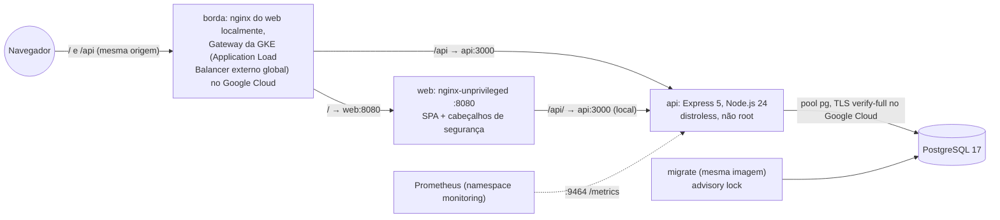

# dx03v2

Metade de aplicação do lab de DevOps no Google Cloud: um mural de mensagens pequeno (API Express 5, página React 19, PostgreSQL 17) com containers, manifests Kubernetes para o GKE Autopilot e um teste ponta a ponta em kind.

[](https://github.com/maringelix/dx03v2/actions/workflows/ci.yml)

[English](README.md)

## O que é

Um lab público e educacional para clonar ou fazer fork e aprender como um app web pequeno é
construído, testado, empacotado e publicado em Kubernetes com segurança. Tudo é provado por um
harness local que não precisa de conta na nuvem: lint, checagem de tipos, testes unitários e de
integração contra um PostgreSQL de verdade, build das imagens com gate de vulnerabilidades e um teste
ponta a ponta em um cluster kind local. O caminho Google Cloud (GKE Autopilot construído pelo
`tx03v2`, tráfego pelo Gateway da GKE num Application Load Balancer externo global com Cloud Armor)
está pronto, mas **nunca rodou na nuvem**: a matriz de status diz exatamente o que está provado e
como.

Este repositório roda o mesmo aplicativo do `dx01v2` (AWS) e do `dx02v2` (Azure), para a comparação
entre nuvens ser justa: só o destino do deploy muda. Como eles ficam em sincronia está no
[docs/ARQUITETURA.md](docs/ARQUITETURA.md) e no [docs/SUSTENTACAO.md](docs/SUSTENTACAO.md).

A família do lab (v2):

| Repositório | Nuvem | Papel | Status |
|---|---|---|---|
| [`tx01v2`](https://github.com/maringelix/tx01v2) | AWS | infraestrutura (Terraform, EKS, RDS, camada de plataforma) | veja a matriz de status dele |
| [`dx01v2`](https://github.com/maringelix/dx01v2) | AWS | aplicação (o mesmo app deste repositório) | veja a matriz de status dele |
| [`tx02v2`](https://github.com/maringelix/tx02v2) | Azure | infraestrutura (Terraform, AKS, PostgreSQL, camada de plataforma) | veja a matriz de status dele |
| [`dx02v2`](https://github.com/maringelix/dx02v2) | Azure | aplicação (o mesmo app deste repositório) | veja a matriz de status dele |
| [`tx03v2`](https://github.com/maringelix/tx03v2) | GCP | infraestrutura (Terraform, GKE Autopilot, Cloud SQL, Cloud Armor, camada de plataforma) | irmão deste repositório, veja a matriz de status dele |
| `dx03v2` (este repositório) | GCP | aplicação (construída sobre o `docs/CONTRATO.md`) | ver matriz de status |

## Matriz de status

| Capacidade | Status | Evidência |
|---|---|---|
| Lint, formatação e checagem de tipos (eslint, prettier, tsc para `api` e `web`) | `verificado no CI` | `make static` (`eslint`, `prettier`, `typecheck:*`); job `static` do CI |
| Dockerfiles, workflows e scripts (hadolint, actionlint, shellcheck) | `verificado no CI` | `make static` (`hadolint`, `actionlint`, `shellcheck`) |
| Manifests Kubernetes: render do kustomize + kubeconform estrito (local, gcp, gcp-waf) com schemas da Gateway API v1.5.0 gerados do asset oficial da release e os de `networking.gke.io` de um commit fixado do catálogo, asserções de contrato e de hardening, trivy config | `verificado no CI` | `make static` (`crd-schemas`, `kubeconform`, `contract-app`, `trivy-config`) |
| Script de deploy contra o contrato v1 (as 15 chaves do Parameter Manager, valores fixos, raiz da CA do Cloud SQL, os dois overlays, chamadas `gcloud` só de leitura) | `verificado no CI` | `make static` (`contract-app`) |
| Scan de segredos e políticas do repositório (só identificadores placeholder, actions e imagens fixadas, só Workload Identity Federation, regressões do v1, sem restos dos caminhos AWS e Azure) | `verificado no CI` | `make static` (`gitleaks`, `policy-*`, `repo-structure`, `version-consistency`) |
| Testes unitários + de integração da API contra um PostgreSQL 17 real (gate de cobertura: linhas >= 80 %, branches >= 70 %), inclusive o `X-Forwarded-For` do load balancer do Google Cloud | `verificado no CI` | `make test` (`test:api`); job `test` do CI |
| Testes da página com Testing Library + jsdom (gate de cobertura: linhas >= 70 %) | `verificado no CI` | `make test` (`test:web`); job `test` do CI |
| Imagens: build, usuário numérico não root, sem npm nem shell no runtime da API, gate HIGH/CRITICAL do trivy | `verificado no CI` | `make build`; job `images` do CI |
| Stack do compose (PostgreSQL → migrate → api → web em 127.0.0.1) + smoke test | `verificado localmente` | `scripts/dev-env.sh`, `scripts/compose-smoke.sh` (manual, fora do CI) |
| Ponta a ponta no kind: Pod Security `restricted`, smoke test pelo nginx, enforcement de NetworkPolicy | `verificado no CI` | `make e2e` (`scripts/e2e-kind.sh`); job `e2e` do CI |
| Deploy no Google Cloud (push no Artifact Registry, GKE Autopilot do tx03v2, ExternalSecrets do Secret Manager, Gateway da GKE + Cloud Armor, smoke test pelo load balancer) | `não executado em nuvem (v2)` | `.github/workflows/deploy-gcp.yml`, `scripts/deploy-gcp.sh`, `docs/RUNBOOK.md` |
| HTTPS no listener do Gateway | `planejado` | precisa de um certificado; fora do contrato v1 (`docs/CONTRATO.md`) |
| Overlay `local-platform` para o lab local do tx03v2: render do kustomize + kubeconform estrito, asserções contra o contrato local e os kinds do AppProject `dx03v2`, cinco regras de alerta testadas com promtool | `verificado localmente` | `make static` (`kubeconform`, `contract-app`, `promtool-rules`) num contêiner Linux; ainda não no CI |
| **O app na plataforma local completa do tx03v2** (kind + Artifact Registry, Cloud SQL, armazenamento de objetos, load balancer e servidor git emulados): imagens no registry do lab, GitOps com Argo CD (Synced, Healthy, self-heal) | `verificado localmente` | `make e2e-platform` (`scripts/deploy-local.sh`, `scripts/e2e-platform.sh`, `docs/LAB_LOCAL.md`); job `e2e-platform` do CI |
| HTTPS pelo load balancer emulado e um Gateway do Istio (cert-manager, CA do lab), smoke test de fora do mesh (`SMOKE_EDGE=istio`); TLS `verify-full` no banco | `verificado localmente` | `make e2e-platform` (sonda `smoke`) |
| Istio ambient: mTLS `STRICT`, `AuthorizationPolicy` por identidade, NetworkPolicies com HBONE; Prometheus, dashboard do Grafana, Loki; Gatekeeper, Trivy Operator, HPA 2-4; ensaio de backup + restore do banco; experimento de chaos | `verificado localmente` | `make e2e-platform` (sondas `mesh`, `observability`, `trivy`, `hpa`, `backup`, `chaos`) |
| Configurações do repositório como código (ruleset, environment `lab`) | `planejado` | `scripts/repo-guardrails.sh`, `docs/PUBLICACAO.md` |

As linhas `verificado no CI` rodam nos jobs do CI da coluna Evidência (`HARNESS_STRICT=1`, em todo
pull request, todo push na `main` e semanalmente) e passam localmente em containers Linux. A linha do
compose continua `verificado localmente`. O `scripts/deploy-gcp.sh` também
rodou offline contra `gcloud`/`kubectl`/`docker` simulados (13 cenários, docs/HARNESS.md); isso não é
uma rodada em nuvem. A linha do Google Cloud só muda com uma issue `cloud_run_report` (data, região,
commits, custo, saída do smoke, sobras).

## Arquitetura



- Local (compose) e kind: um proxy reverso (o nginx do web) na frente da API (`TRUST_PROXY_HOPS=1`).
- Google Cloud: o controlador de Gateway da GKE (gerenciado pelo Google) programa um Application Load
  Balancer externo global que leva `/api` para a API e `/` para o web por NEGs zonais, com a política
  do Cloud Armor do tx03v2 nos dois backends. Ele acrescenta `<ip do cliente>,<ip do load balancer>`
  ao `X-Forwarded-For` e conecta a partir de um Google Front End, então a API confia em dois saltos
  (`TRUST_PROXY_HOPS=2`). Os segredos vêm do Secret Manager pelo External Secrets; o banco é o Cloud
  SQL por um endpoint Private Service Connect. Namespace, RBAC, o endereço reservado, Cloud Armor,
  Cloud SQL e a camada de plataforma são do tx03v2.
- Decisões de design, diagramas por ambiente, a tabela AWS / Azure / Google Cloud e a tabela v1 → v2:
  [docs/ARQUITETURA.md](docs/ARQUITETURA.md).

## Início rápido (grátis, local)

Você precisa de Docker e do devcontainer ou de Linux/WSL 2 com bash >= 4.4, Node.js 24 (`.nvmrc`),
curl, unzip, xz, git e make.

```bash
git clone https://github.com/maringelix/dx03v2.git && cd dx03v2
make tools                     # ferramentas fixadas em .tools/, SHA256 conferido
HARNESS_STRICT=1 make verify   # checks estáticos + testes (sobe um PostgreSQL descartável no Docker)
make build                     # as duas imagens + gate do trivy
make e2e                       # cluster kind dx03v2-e2e: deploy, smoke test, sondas de NetworkPolicy
```

Rodar o app:

```bash
scripts/dev-env.sh                                  # .env com segredos aleatórios (ignorado pelo git)
docker compose -p dx03v2-dev up -d --build --wait   # http://127.0.0.1:8080
scripts/compose-smoke.sh                            # o mesmo smoke test do kind e do Google Cloud
docker compose -p dx03v2-dev down -v
```

No Windows ou macOS, abra a pasta no devcontainer (`.devcontainer/devcontainer.json`, com
Docker-in-Docker); ele roda `make tools` para você. Nada aqui toca o Google Cloud. Referência da API
com exemplos em curl: [docs/API.md](docs/API.md).

## Caminho na nuvem (custa dinheiro)

**Custo primeiro:** o app roda no lab do tx03v2, que custa cerca de US$0,12 por hora em us-central1
com os padrões enquanto o free tier da GKE cobre a taxa do cluster, e cerca de US$0,22 por hora sem
ele (cerca de US$90-160 por mês se esquecido). O que este repositório acrescenta são os pods do app no
Autopilot (cobrados pelos requests) e o load balancer que o Gateway programa (cerca de US$0,025 por
hora pela forwarding rule mais os dados, e cerca de US$0,011 por hora pelo Cloud Armor). São
estimativas a partir dos preços de tabela lidos em 2026-10-11, não verificadas numa fatura, e a sua
conta de faturamento pode usar outra moeda: veja o
[documento de custos do tx03v2](https://github.com/maringelix/tx03v2/blob/main/docs/CUSTOS.md). Use
um projeto dedicado com budget e destrua no mesmo dia.

Siga o [docs/RUNBOOK.md](docs/RUNBOOK.md): bootstrap/apply/plataforma do tx03v2 → variáveis do
GitHub do dx03v2 → workflow `deploy-gcp` (ou `scripts/deploy-gcp.sh` depois de `gcloud auth login`)
→ smoke test pelo load balancer → destroy do tx03v2 + checagem de sobras → issue `cloud_run_report`.

## Harness

| Alvo | O que roda | Quando |
|---|---|---|
| `make help` | lista os alvos | a qualquer momento |
| `make tools` | `scripts/install-tools.sh`: trivy 0.75.0, hadolint 2.15.1, actionlint 1.7.12, shellcheck 0.11.0, kubeconform 0.8.0, gitleaks 8.30.1, kind 0.33.0, kubectl 1.36.5, promtool 3.15.0 | uma vez, e depois de atualizar uma ferramenta |
| `make static` | `scripts/harness.sh static` | antes de cada push |
| `make test` | `scripts/harness.sh test` (PostgreSQL 17 real: `DB_*` ou um container descartável) | antes de cada push |
| `make verify` | static + test | antes de cada PR |
| `make build` | `scripts/harness.sh build`: build npm, imagens, política de imagem, gate do trivy | quando código, Dockerfiles ou dependências mudam |
| `make e2e` | `scripts/harness.sh e2e`: cluster kind, smoke test, sondas de NetworkPolicy | quando manifests, imagens ou o app mudam |
| `make e2e-platform` | `scripts/harness.sh platform`: o app na plataforma local completa do tx03v2 (clona o tx03v2 em `deploy/local/tx03v2.ref`), sempre destruída no fim (job `e2e-platform` do CI) | quando manifests, imagens ou o app mudam; precisa de Docker com 8 GB |
| `make all` | todos os estágios | antes de um merge com cara de release |
| `make clean` | remove `.tools/`, saída de build, cobertura, `node_modules` e dados temporários | — |

`scripts/harness.sh list` imprime todos os checks. O workflow `deploy-gcp` instala o Google Cloud
CLI 588.0.0 com o `gke-gcloud-auth-plugin`; você só precisa do seu gcloud para o caminho na nuvem.
Detalhes: [docs/HARNESS.md](docs/HARNESS.md).

## Documentação

Toda a documentação está em português do Brasil.

| Documento | Conteúdo |
|---|---|
| [docs/ARQUITETURA.md](docs/ARQUITETURA.md) | diagramas (local, kind, Google Cloud), decisões, AWS / Azure / Google Cloud, v1 → v2 |
| [docs/API.md](docs/API.md) | endpoints, erros, exemplos com curl |
| [docs/CONTRATO.md](docs/CONTRATO.md) | contrato v1 tx03v2 ⇄ dx03v2 (lado do app; fonte da verdade no tx03v2) |
| [docs/RUNBOOK.md](docs/RUNBOOK.md) | desenvolvimento local, compose, e2e no kind, deploy no Google Cloud |
| [docs/LAB_LOCAL.md](docs/LAB_LOCAL.md) | o app na plataforma local do tx03v2 (deploy GitOps, sondas, limites) |
| [docs/GUARDRAILS.md](docs/GUARDRAILS.md) | regras, onde são aplicadas, exceções, limites |
| [docs/HARNESS.md](docs/HARNESS.md) | checks, modo estrito, o teste offline do deploy, problemas comuns |
| [docs/SUSTENTACAO.md](docs/SUSTENTACAO.md) | rotinas, calendário de fim de suporte, procedimentos, paridade com o dx01v2 e o dx02v2 |
| [docs/PUBLICACAO.md](docs/PUBLICACAO.md) | checklist para tornar o repositório público |

## Contribuindo

Leia o [CONTRIBUTING.md](CONTRIBUTING.md) e o [AGENTS.md](AGENTS.md) (também para humanos).
Problemas de segurança: [SECURITY.md](SECURITY.md).

## Licença

[MIT](LICENSE) — Copyright (c) 2025-2026 Bruno Maringeli.
